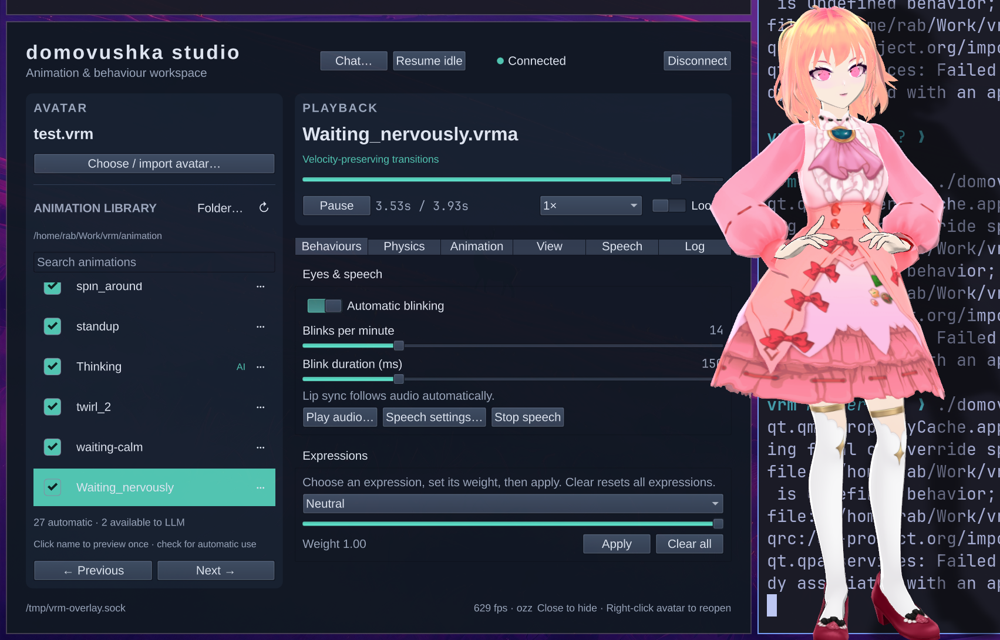

# domovushka



An animated desktop companion for Linux/X11 and Wayland, with a Qt Quick control window,
**domovushka studio**.
The C/C++ runtime renders VRM/glTF models, plays VRMA/GLB animations, simulates
spring bones, and drives expressions and lip sync through JSON IPC.

## Build and launch

Requires a C11/C++20 toolchain, GNU Make 4.3+, CMake, pkg-config, and development
packages for libepoxy, GLFW, X11 and Xext, plus wayland-client, wayland-egl,
EGL, Cairo and wayland-protocols for the native backend. Python 3.10+, PySide6 and keyring are
needed for Studio and chat. The renderer itself has no Qt dependency.

```sh
git clone --recurse-submodules https://github.com/rabfulton/VRM.git
cd VRM
make -j4
python3 -m venv .venv
source .venv/bin/activate
python3 -m pip install -r requirements-gui.txt
./domovushka --studio
```

For an existing clone, initialize dependencies with
`git submodule update --init --recursive` before building. The retained submodule
is ozz-animation; other runtime libraries are vendored under `deps/`.

The [CC0 starter pack](assets/starter/README.md) includes an anime avatar, a fox,
14 humanoid motions and seven fox animations. Open **Choose / import avatar…**
in Studio for a thumbnail gallery, the included anime avatar and creator download
pages. Import a downloaded VRM, GLB, glTF or ZIP; **My avatars** keeps local copies
between sessions. See [avatar imports](docs/avatars.md). A fresh clone can run with
`./domovushka --studio`; existing saved/local avatars are preserved.
Additional user avatars, animations, speech downloads and local settings stay
ignored by Git. See [asset setup](animation/README.md).
The `domovushka` launcher uses this checkout's `.venv` when present, otherwise
the current Python interpreter. Run `./domovushka` for just the companion, or
`./domovushka --studio` to open the controls. All existing command-line options
are supported, and `control.py` remains a compatibility entry point. Saved
preferences, imported avatars and keyring credentials are retained.

## X11 and Wayland

The default build includes both window backends and chooses one at runtime.
On a Wayland session, it tries a native transparent layer-shell overlay when
`WAYLAND_DISPLAY` is set. If the compositor cannot provide it, the renderer
reports a fallback to X11/XWayland. Studio and Chat use Qt's platform selection
independently.

```sh
./domovushka --studio                         # Automatically select the backend
./domovushka --window-backend wayland --studio # Require native Wayland
./domovushka --window-backend x11 --studio     # Require X11 or XWayland
```

Explicit backend selections never fall back. The renderer accepts the same
`--window-backend` option; `VRM_WINDOW_BACKEND=x11` or `wayland` overrides automatic
selection. To build only one backend, use `make WINDOW_BACKEND=x11` or
`make WINDOW_BACKEND=wayland`. The Wayland-only build has no direct GLFW, X11 or
Xext dependency; build objects are kept separate for each configuration.

Native Wayland support currently targets compositors with `wlr-layer-shell` and
has been exercised on Hyprland. The avatar appears on a transparent canvas with
input restricted to its silhouette: gaps and shadows stay click-through. Left-drag
to move the avatar within its output, middle-drag to orbit, and scroll to zoom.
Right-click opens a native **Chat / Studio / Quit** popup at the pointer.

This first native implementation uses one compositor-selected output with integer
scaling. Fractional scaling, explicit output selection and migration, and
fullscreen-aware visibility are still pending. The compositor controls placement
and focus for Studio and Chat. See [native Wayland support](docs/wayland.md) for
current behavior, validation and limits.

## Companion controls

The desktop entry in [packaging/domovushka.desktop](packaging/domovushka.desktop)
is provided for future packaging. It expects the
`domovushka` command to be installed on `PATH`.

Studio remembers the selected model and animation folder. On a new session it
enables blinking, plays a configured startup once, then moves to an idle.
Use **⋯** beside an animation to edit looping, startup, idle, pose and floor-contact properties in its
`.cfg` file; see [animation properties](docs/animation-properties.md).

The companion starts with Studio hidden. Right-click the avatar for **Chat**,
**Studio** and **Quit**. The X11 menu also includes **Always on top**; rendering
preferences remain available in Studio. The floating preference is remembered
across restarts. Right-click again or left-click outside to dismiss the menu.
Closing Studio or chat keeps the companion running;
**Quit** stops it. Pass `--studio` to open the controls immediately. Missing assets
or errors open Studio for setup and recovery. The avatar requests exclusion from
X11 taskbars and window lists. Animations marked `is_idle` take turns while the
companion is free; use **Resume idle** after manual playback or testing.
To manage the renderer separately:

```sh
./vrm-overlay --socket /tmp/my-avatar.sock /path/to/avatar.vrm
./domovushka --attach --socket /tmp/my-avatar.sock
```

The runtime supports one active controller connection. Disconnect Studio before
connecting another client. Use a separate socket for each independent instance.

## Capabilities

- Transparent avatar window, camera controls and toon/anime/PBR rendering.
- Animation library, playback/seek/loop controls and velocity-preserving ozz transitions.
- Fixed-step spring simulation with garment/arm collision proxies and diagnostics.
- Flat-floor foot planting with leg IK and smooth contact release.
- VRM expressions, automatic blinking and lip sync enabled by default.
- API chat with streamed replies, system-keyring credentials, sentence speech,
  animation master switches and separate per-animation LLM permissions.
- Local speech with Nano/CrispASR on Vulkan by default; selectable Turbo, Kokoro,
  Piper and custom CrispASR backends, with saved profiles and optional CPU processing.

In Studio's **Speech** tab, select **Prepare voice**, then try a preview. Native
engines and models download separately; no Python ML stack is required.
See [speech setup and limits](docs/tts.md). Open **Chat…**, choose **Chat** from the avatar's right-click menu,
or press Ctrl+Enter while the app has focus to start a conversation. Chat Settings
select the API endpoint/model and save its key to your system keyring. Replies
speak sentence by sentence as they stream; see the [chat guide](docs/chat.md).
The Speech tab remains a whole-WAV voice preview.

Physics uses skeleton proxies rather than full cloth mesh contact. Foot planting
currently assumes a flat floor. Desktop window interaction, microphone input and
system-audio reactions remain planned work; see the [roadmap](docs/roadmap.md).

## Control from code

Commands are newline-delimited JSON over a Unix socket, defaulting to
`/tmp/vrm-overlay.sock`. From this checkout:

```python
from vrm_overlay import IpcClient

with IpcClient() as avatar:
    avatar.load_model("/path/to/avatar.vrm")
    avatar.auto_blink_enable(True)
    print(avatar.request({"action": "list_expressions"}))
```

See the [IPC reference](docs/api.md) for animation, expressions, streamed PCM,
state queries and tuning commands. The shared Python client consumes replies,
matches request IDs and raises `IpcError` on rejected commands.

## Documentation and checks

- [Native Wayland support](docs/wayland.md)
- [Studio guide](docs/studio.md)
- [API chat and character actions](docs/chat.md)
- [Local speech](docs/tts.md)
- [Window fitting and mirrored animations](docs/window-fitting.md)
- [Motion and clothing contacts](docs/motion.md)
- [Foot planting](docs/foot-planting.md)
- [Architecture and timing](docs/architecture.md)
- [Development and testing](docs/development.md)

```sh
make test            # Headless native/Python regressions; no model or AI service
make test-sanitize   # Native checks with ASan/UBSan
make test-ui         # Real renderer and local reference assets; X11/audio required
make test-speech     # Also synthesize real Nano on Vulkan; downloads may be needed
make test-chat       # Streamed local LLM fixture + real renderer/Nano; no API bill
make test-fit        # Rendered-pixel clipping check for both push animations
```

When PySide6 is installed, the headless suite also tests actual QML controls
with offscreen rendering. Integration asset requirements and path overrides are
in the [development guide](docs/development.md).
