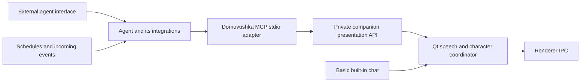

# External agents and the avatar MCP server

## Product direction

Domovushka supplies a desktop avatar to external agents through MCP. The built-in
chat remains the basic standalone option. Advanced users use their agent’s own
interface, tools, permissions and conversation history; Studio configures the
avatar, voice and animation library in either mode.

File searching, beets/playerctl, mail connectors and recurring agent jobs belong
to the external agent and its integrations. Domovushka does not need a general
agent harness or executable-plugin platform to support those workflows. An agent
can search for a file or handle a scheduled check, then ask the avatar to present
its result. Keep the existing text chat simple rather than duplicating those tools.

See [MCP setup and tool contract](mcp.md) for the implemented integration.

## Boundaries

The MCP adapter is a separate process for each agent connection. It attaches to
an already running companion; closing the agent does not quit the avatar. The
companion accepts multiple adapter sessions and serializes presentations. Studio’s
controller remains the single renderer IPC owner. No adapter opens the renderer
socket directly.

The Python MCP SDK supplies protocol negotiation, stdio framing, discovery and
schema validation. It is optional and is not imported by the normal launcher or
renderer. The private companion API validates requests again and assigns session
identity from each connection. Callers cannot supply another session’s identity.

External-agent mode disables built-in chat requests. Switching source cancels
pending external presentations and the active built-in turn. Speech preparation
and manual previews remain local Studio controls. Manual animation actions can
supersede presentations; mode, model, library, voice and access changes invalidate
pending work. Local Stop external output cancels all external presentations.

## Presentation semantics

Presentations use named, allowed capabilities and plain spoken text. They do not
expose arbitrary renderer commands, local file paths, voice preparation, shell
execution or model credentials. Existing per-animation master and LLM-access flags
also determine which gestures an external agent may request. Expressions come
from the loaded avatar’s actual supported mappings.

An accepted request gets an opaque ID and moves through queued, running,
presenting and a terminal completed/cancelled/failed state. Acceptance does not
mean speech has finished. The companion uses its existing audio drain detection,
pose bridges and idle handoff. Gestures play one pass. Expressions are released
after the presentation; expression-only requests hold for about four seconds.

Work and status are in memory, scoped to the connection that created them.
Disconnecting an agent cancels that session’s unfinished presentations. Cancelling
one presentation cannot stop another session’s work or a superseding local voice
preview. New companion/model sessions do not restore old IDs or replay speech.
Queue size, retained status entries, input sizes and execution time are bounded.

Visibility is a companion-wide control shared by Studio, the right-click menu,
the global shortcut and MCP. Hide cancels all output and optionally plays an exit;
summon replays the entrance. These controls work in either conversation mode and
persist beyond the requesting adapter session. Hidden/exiting companions reject
new presentations until explicitly summoned. See [visibility tools](mcp.md).

## Extending this direction

Keep the presentation API independent of MCP so basic chat and later integrations
share speech/character behaviour. Add avatar capabilities such as pointing,
visual effects, captions or externally supplied audio when implemented and tested.
Publish those capabilities accurately rather than advertising planned actions.

A Markdown guide for an external agent should describe the available tools, how
to discover permitted actions, how to use speech sparingly, and how to handle
acceptance, failure and cancellation. [The current guide](mcp.md) supplies these
instructions. Agents can combine them with their own skill/plugin conventions;
domovushka does not need to define a competing general skill manifest.

MCP output is not automatically a complete agent frontend. Typing in Studio or
using a microphone to start turns in an external agent would require an explicit
agent connection. Nor does exposing MCP automatically wake an interactive host
when mail arrives: scheduling and unsolicited event delivery depend on the chosen
host/integration. Optional MCP sampling is not assumed by this implementation.

Future work can include richer progress, lower-latency streaming presentation,
additional transports with authentication, and agent-specific input adapters.
The initial implementation supports local stdio tools only, through a private
same-user companion socket. It exposes no HTTP listener, sampling, task protocol,
mail watcher, cron installer, filesystem tool or executable user-plugin runtime.
