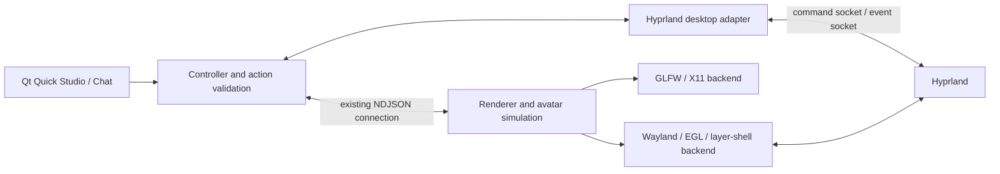

# Native Wayland implementation plan

Status: design only; no Wayland backend is implemented by this document.
Primary target: **Hyprland on Omarchy**. Research checked on **2026-10-27**.
Recheck the installed compositor, protocols and Omarchy configuration format when
work starts on the target machine. The current X11 application remains supported.

## Intended result

Run the avatar and Qt Quick windows as native Wayland clients. Preserve transparent
rendering, avatar-only pointer input, dragging, wheel zoom, startup/idles, Chat,
Studio and reliable Quit. Add Hyprland desktop awareness separately, then sitting
on a selected window and opt-in movement/shaking of selected floating windows.
Speech, lip sync, the existing LLM/TTS providers and their keyring storage carry
over. Vulkan remains the speech-inference default; this port does not require
rewriting the OpenGL renderer in Vulkan.

The first usable release should work without a Hyprland plugin or XWayland.
Broader compositor support is a later capability-based extension, not a requirement
to finish the Hyprland release.

## Current code and portability boundaries

| Current code | Work required |
| --- | --- |
| `src/platform.c`, `src/platform.h` | Separate GLFW/X11 implementation from a native Wayland/EGL backend. Xlib, XShape, window coordinates and WM hints are currently unconditional. |
| `src/main.c` | Separate avatar position, render viewport and native surface geometry. Replace screen-position arithmetic in dragging, fitting, settings and menu requests. |
| `src/renderer.c`, `src/camera.c`, `src/bounds.c` | Retain shaders/skinning and camera math; introduce an explicit presentation rectangle for the Wayland output surface. |
| `src/input_mask.c`, `src/hit_capture.c` | Reuse avatar-only stencil coverage and asynchronous readbacks; add Wayland region output instead of X11 bitmap submission. |
| `vrm_overlay/qt_controller.py`, `qt_chat.py`, QML | Keep ordinary Qt Wayland windows, but replace global-cursor positioning and cross-process popup assumptions. |
| `Makefile` | Make GLFW/X11/Xext dependencies conditional; add Wayland protocol generation and EGL linking. |
| `tests/desktop_smoke.py`, `tests/zoom_smoke.py` | Keep X11 tests; provide Wayland equivalents without xdotool/XShape/window-pixmap capture. |

The existing desktop-interaction work is still a roadmap item: there is no
finished X11 window-pushing subsystem to port. Its public interface should be
designed for both platforms. See [architecture](docs/architecture.md),
[window fitting](docs/window-fitting.md), and [desktop actions](docs/chat.md#desktop-actions-and-the-chat-ui-direction).

## Recommended architecture

Use **libwayland-client + EGL + layer-shell** for the avatar. Keep GLFW for X11.
Keep Qt Quick for Studio/Chat, and put Hyprland IPC behind a separate desktop
adapter owned by the Python controller.



Ordinary Wayland toplevels do not provide the global positioning used here;
GLFW documents its position functions as unavailable on Wayland. Merely enabling
GLFW's Wayland support would not preserve the overlay design.
[GLFW window-position restrictions](https://www.glfw.org/docs/latest/group__window.html),
[Qt positioning restrictions](https://doc.qt.io/qt-6/application-windows.html#wayland-peculiarities).

A GLFW-created surface already has a shell role. Do not try to turn that surface
into a layer surface through native-handle access. Own the Wayland surface and
its role from creation. Avoid private Qt QPA hooks as a shortcut: they have no
source/binary compatibility guarantee.
[Surface roles](https://wayland.freedesktop.org/docs/html/apa.html#protocol-spec-wl_surface),
[Qt QPA compatibility](https://doc.qt.io/qt-6/qpa.html).

### Backend contracts

Proposed names and flags below are design sketches, not existing APIs.

- Split into `platform_x11.c` and `platform_wayland.c`, with a small backend-neutral
  facade. Keep Wayland object types out of simulation and rendering headers.
- Expose output descriptions, logical surface size, framebuffer size, scale,
  pointer events, presentation scheduling and input-region updates.
- Distinguish **avatar scene position** from **OS window position**. Replace calls
  that assume every backend can get/set global window coordinates with explicit
  capabilities or avatar-placement operations.
- Report capabilities such as `avatar_input_region`, `native_popup`,
  `desktop_window_geometry`, `floating_window_move` and `global_shortcuts`.
  Determine them from the actual connection, not only environment variables.
- Proposed build selection: `WINDOW_BACKEND=x11|wayland|both`. A Wayland-only
  build must not require X11/Xext or GLFW. Use separate object directories so
  changing backends cannot accidentally reuse incompatible objects.
- Proposed runtime selection: `--window-backend=auto|x11|wayland` and
  `--desktop-backend=auto|none|hyprland`. In auto mode, prefer a usable native
  Wayland overlay on Hyprland. Missing layer-shell must produce a clear capability
  failure or an explicitly reported X11 fallback, never a silent tiled avatar.

## Wayland avatar surface

### Placement and presentation

Start with one transparent layer surface covering the **selected output's logical
area**. Anchor all four edges, request compositor-assigned dimensions, and move
the avatar within that canvas. Wheel zoom changes the avatar's presentation
rectangle rather than resizing the native surface. This gives dragging, startup
entrances and animation bounds one stable coordinate frame and avoids recreating
the resize churn recently addressed on X11.

Use a stable layer namespace, e.g. `vrm-overlay`, the `top` layer initially,
keyboard interactivity `none`, and exclusive zone `-1`: this reserves no space
and gives the full-output layout instead of allowing other exclusive panels to
shift the canvas. Treat panel avoidance as placement policy. Do not use a
fullscreen **toplevel** for this purpose. Layer surfaces have their own rules;
the absence of a normal taskbar/switcher entry must be checked on Hyprland.
[Layer-shell protocol text](https://wayland.app/protocols/wlr-layer-shell-unstable-v1),
[Hyprland layer rules](https://wiki.hypr.land/configuring/core/rules/layer-rules/).

Use an alpha-capable EGL configuration and premultiplied-alpha presentation.
Request desktop OpenGL 3.3/core through EGL to match the existing GLSL shaders;
do not accidentally select an OpenGL ES context. Keep depth/stencil/MSAA support
in the offscreen renderer and check EGL/context creation failures explicitly.
Leave the surface opaque region empty. Keep the initial input region empty and
the avatar hidden through configure/setup; present the first animation pose only
when startup is ready. Acknowledge configure serials before the corresponding
buffer commit; resize the EGL window only to the accepted buffer dimensions.

**Keep large buffers under control.** An output-sized surface does not imply
output-sized MSAA and stencil readbacks. Render the avatar/shadow into a bounded
offscreen rectangle using the existing renderer, then resolve/present it into the
output canvas. Read back only that rectangle for hit testing. Allocate presentation
surfaces only for active outputs, not every connected monitor up front. Measure
the remaining single-sample output-buffer cost on 4K displays before expanding
to several active outputs. If damage/buffer-age optimizations are added, track
previous and current avatar rectangles and clear stale pixels correctly; use a
full transparent clear until damage history is proven correct.

Default policy should yield to lock screens and hide on fullscreen applications
on the avatar's output. Never enable an above-lock layer rule. Verify coexistence
with Omarchy launchers, panels and notification layers rather than assuming `top`
means “above everything.” A more intrusive overlay mode can be an explicit option.

### Input and click-through

Convert the existing logical silhouette bitmap into merged scanline rectangles
for a `wl_region`, then apply it using `wl_surface.set_input_region`. Preserve
holes, exclude the shadow, and translate the cropped readback into canvas
coordinates. Merge identical runs on adjacent rows to keep protocol traffic small.
An **empty region** means click-through; a **NULL input region restores the default
unrestricted region**, so it is not the replacement for an empty XShape mask.
[Core input-region semantics](https://wayland.freedesktop.org/docs/html/apa.html#protocol-spec-wl_surface-request-set_input_region).

Keep GPU readbacks asynchronous, reject stale results after output/scale changes,
and tie region updates to the appropriate surface commits. Preserve the last
valid mapped silhouette briefly during zoom; hidden/unloaded avatars must clear
input immediately. Define and test the permitted one-to-two-frame mask lag.
Never replace a difficult silhouette with a full-output input rectangle.

Handle left-button drag, middle-button orbit and pointer-axis zoom using
surface-local logical coordinates. Test implicit pointer-grab behaviour when a
drag crosses the silhouette or an output boundary; define cancellation when the
seat disappears or the compositor cancels interaction. Do not depend on a global
mouse-position API or synthesize pointer events in production.

### Popup menu and Qt windows

This needs an explicit design, not a direct port of `QCursor.pos()` plus QML
window `x`/`y`. The renderer and Studio use different Wayland connections.

Implement the three-action **Chat / Studio / Quit** menu as a renderer-owned
`xdg_popup` attached to the layer surface through layer-shell's popup association.
Keep pointer serials and popup ownership in that process. Use the triggering
pointer-button serial for an explicit popup grab where appropriate; dismiss on
outside interaction and test Escape/focus behaviour. The avatar normally remains
keyboard-inactive; any temporary menu keyboard interactivity must be restored on
every dismissal path.
[Layer popup association](https://wayland.app/protocols/wlr-layer-shell-unstable-v1#zwlr_layer_surface_v1:request:get_popup),
[XDG popup protocol](https://wayland.app/protocols/xdg-shell#xdg_popup).

Send the chosen action to Studio through the existing IPC/event mechanism.
Studio/Chat remain normal Qt Wayland toplevels with stable application identities.
For user-triggered focus transfer, prototype `xdg-activation-v1`: the renderer
obtains a legitimate activation token and the Qt client consumes it. Confirm how
the shipped PySide6/Qt version accepts tokens for an already-running window;
do not assume an environment variable fixes activation after launch. Allow the
compositor to deny activation. Exact “chat beside avatar” placement is a later
Hyprland adapter feature, not a generic Qt positioning promise.
[Activation protocol](https://wayland.app/protocols/xdg-activation-v1),
[Qt Wayland client integration](https://doc.qt.io/qt-6.10/qtwaylandclient-index.html).

The existing QML menu can remain the X11 implementation. Do not reintroduce a
native Studio/debug UI merely to implement this small platform popup.

### Scaling, outputs and frame scheduling

Represent coordinates explicitly:

| Space | Units / ownership |
| --- | --- |
| Avatar world | Existing model/render units; independent of desktop scale |
| Output canvas | Surface-local logical coordinates, top-left origin |
| Presentation/readback | Physical buffer pixels, with the existing GL origin conversion |
| Desktop scene | Hyprland layout coordinates, output identity and workspace identity |

Use negotiated `wp_fractional_scale_v1` with `wp_viewporter` where available;
fall back to integer output scale. For fractional scale, use an appropriately
rounded physical buffer, the logical viewport destination, and protocol-correct
buffer scale. Do not multiply fractional and integer scaling twice. Update the
camera, presentation rectangle, popup anchor and input region as one layout
generation after scale/output configuration changes.
[Fractional scaling](https://wayland.app/protocols/fractional-scale-v1),
[Viewporter](https://wayland.app/protocols/viewporter).

Persist avatar placement as an output identifier plus logical position/normalized
placement, not the old X11 window rectangle. Start with one chosen output; then
add migration, rotated outputs, negative layout coordinates and unplug fallback.
Define whether a crossing avatar transfers to the next output or is rendered
across two surfaces. Validate that handoff separately; do not render two independent
animation/physics simulations for one avatar.

Integrate the Wayland display fd with IPC and timer handling. Follow the client
library's prepare-read/dispatch/flush/cancel-read contract; do not add blocking
roundtrips or one thread that races dispatch on the same queue. Use frame callbacks
to pace presentation with bounded outstanding work. Commands and Quit must remain
serviceable when frame callbacks stop because the surface is hidden or the output
is off. Keep audio-sample lip-sync timing and the bounded 120 Hz spring clock;
resume without simulating an unbounded hidden-time backlog.
[Wayland client event-loop API](https://wayland.freedesktop.org/docs/html/apb.html).

## Hyprland desktop adapter

Implement this in a Python module such as `vrm_overlay/desktop_hyprland.py`, owned
by the existing controller. It should submit validated desktop snapshots/actions
through that controller's renderer connection, not become a second IPC client.
The renderer consumes contact/placement data but does not execute compositor
commands or receive shell scripts from the LLM.

### Discovery and geometry

Use the compositor instance under
`$XDG_RUNTIME_DIR/hypr/$HYPRLAND_INSTANCE_SIGNATURE/`: short-lived command requests
on `.socket.sock`, persistent notifications on `.socket2.sock`. Hyprland documents
that command connections are synchronous and idle open connections can freeze
the compositor until timeout. Open, request, read and close promptly, with bounded
timeouts and replies; never retain an idle command connection. Reconnect the event
stream with backoff and invalidate old target identities on instance changes.
[Hyprland IPC](https://wiki.hypr.land/ipc/).

Prototype read-only discovery with JSON output from `hyprctl`: outputs, clients,
workspaces and layers. Subscribe before/around the initial snapshot, reconcile
queued events, and resnapshot after reconnect. Events trigger debounced refreshes;
they are not necessarily complete geometry updates. In particular, workspace-move
notifications must not be mistaken for continuous pixel-position notifications.
Use limited, measured geometry refresh while following a target, not a compositor
query per render frame. Hyprland explicitly warns against command spam.
[Queries and command cost](https://wiki.hypr.land/configuring/core/advanced-configuration/using-hyprctl/).

Normalize each target into an opaque app reference, compositor instance/generation,
output/workspace, logical rectangle and floating/fullscreen/visibility state.
Keep window titles as display data, not command selectors. Start with an explicit
target picker or the previously focused app; do not infer occlusion/z-order from
an unordered client list. Exclude this companion's own windows and layer surfaces.
Measure whether reported geometry is the rendered position or an animation goal;
do not promise frame-exact contacts from unverified snapshots.

### Sitting, shaking and pushing

Implement in this order:

1. **Read-only awareness:** choose a target and display/validate its usable upper
   edge. Account for borders, monitor scale and workspace changes.
2. **Sitting on a settled window:** add a kinematic contact surface and seat/foot
   anchors. The current flat-floor foot-lock API is insufficient by itself.
   Retarget/schedule an appropriate sit transition; interpolate small observed
   movement and detach when the target moves too quickly, closes, hides, changes
   workspace or becomes fullscreen.
3. **Bounded shake:** support explicitly selected floating, non-fullscreen windows
   after the user enables movement. Bound duration/amplitude and rate-limit
   compositor requests; verify the actual resulting rectangle.
4. **Pushing:** coordinate hand/body IK, animation and window motion using the same
   contact owner. Clamp movement to sensible output/workarea limits and stop on
   manual user movement. A physically convincing interaction requires more than
   translating a window while playing `push_left` or `push_right`.

Use a version-specific movement adapter. Current Hyprland docs expose Lua window
dispatchers with explicit window selectors and absolute/relative coordinates;
older versions document `movewindowpixel`. Check the target version and select a
tested implementation instead of baking one historical command into the app.
Validate references and numeric arguments; never interpolate window titles or
LLM text into shell commands or Lua. Treat tiled windows as read-only surfaces
initially; do not silently float/rearrange the user's layout.
[Current dispatchers](https://wiki.hypr.land/configuring/core/dispatchers/),
[older dispatcher reference](https://wiki.hypr.land/0.54.0/Configuring/Dispatchers/).

Cancellation must not restore an old position over a new user drag. Restore only
if the target generation still matches and the window remains where our last
accepted command placed it. Otherwise release ownership. If smooth rendered
geometry cannot be obtained cheaply enough, defer continuous pushing; assess a
small optional Hyprland plugin later, with explicit ABI/version maintenance costs.

Advertise actions to the LLM only when implemented, enabled and supported for the
selected target. Keep a typed allowlist such as `sit_on_target` or `shake_target`,
not a general `hyprctl` action. Window inspection and movement remain separately
selectable; sending arbitrary desktop titles/content to the LLM is not required.

## Omarchy integration

### Target-machine inventory before coding

Record read-only diagnostics on the actual installation:

```sh
hyprctl version
hyprctl -j monitors
hyprctl -j layers
hyprctl -j clients
hyprctl configerrors
wayland-info
pacman -Q hyprland wayland wayland-protocols qt6-wayland xdg-desktop-portal-hyprland pipewire wireplumber
printenv XDG_SESSION_TYPE XDG_CURRENT_DESKTOP WAYLAND_DISPLAY HYPRLAND_INSTANCE_SIGNATURE XDG_RUNTIME_DIR
```

`wayland-info` is an optional diagnostic tool; record missing packages instead of
installing anything automatically. Also record Omarchy release/channel, GPU and
driver, actual Qt/PySide6 versions, output scales/refresh rates, portal routing,
and which graphical-session manager is in use. Keep client titles out of shared
diagnostic logs unless needed for a specific reproduction.

### Dependencies and packaging

- Native backend: Wayland client/EGL libraries, libepoxy and EGL-capable OpenGL
  drivers. Use `wayland-scanner` for generated C bindings and versioned protocol
  XML. Include `libxkbcommon` if the popup needs direct keyboard translation.
- Protocol data: standard `wayland-protocols` plus a pinned layer-shell XML and
  its license/source notice, or a suitable installed protocol-data package.
  No compositor-side wlroots library is needed merely to implement a client.
- Studio: verify the Wayland QPA plugin in the actual PySide6 installation, not
  just the presence of a system Qt package. Native smoke tests should explicitly
  use `QT_QPA_PLATFORM=wayland`; retain `xcb` as an intentional X11 test choice.
  [Qt platform-plugin selection](https://doc.qt.io/qt-6/qpa.html).
- Keep the current miniaudio playback path initially. Confirm playback via the
  target PipeWire setup. System-audio reactions are a separate optional PipeWire
  capture/monitor feature, with a non-destructive analysis tap; do not consume
  the playback ring as a second reader. [PipeWire API](https://docs.pipewire.org/page_tutorial.html).
- Test API-key save/read/delete through the existing OS keyring integration on
  a real unlocked login session, and handle locked/unavailable service errors.
  Do not add plaintext key storage as a Wayland workaround.

### Configuration, shortcuts and startup

Keep optional integration in user configuration. Omarchy's current manual lists
Lua Hyprland overrides under `~/.config/hypr/`, including `hyprland.lua`,
`bindings.lua` and `autostart.lua`; older releases use different layouts/syntax.
Inspect the installed config and ship examples for that version. Never modify
Omarchy-managed defaults, replace the user's main config, or assume an old
`windowrulev2`/`.conf` snippet still applies.
[Omarchy dotfile ownership and layout](https://omarchy.org/manual/dotfiles/).

Give the avatar a dedicated namespace and Qt windows stable app IDs. If required,
provide narrowly scoped rules for the avatar namespace and separate Studio/Chat
floating behaviour. Verify no blur, dimming, duplicate shadows or layer fade
interferes with startup/zoom; disable only the relevant effect, not compositor
effects globally. Leave the user's choice of normal Studio tiling intact by default.

For “Open Chat”, prefer the GlobalShortcuts portal where available. Verify XDPH
registration/binding behaviour on the host; an explicit Hyprland keybinding that
calls a narrow companion control command is a practical fallback. That command
must route through the running controller, respecting the existing single-renderer
IPC ownership. It is a proposed control entry point, not an existing CLI feature.
[GlobalShortcuts portal](https://flatpak.github.io/xdg-desktop-portal/docs/doc-org.freedesktop.portal.GlobalShortcuts.html),
[Hyprland shortcut integration](https://wiki.hypr.land/configuring/core/binds/globals/).

Make autostart opt-in and use the installed Omarchy session conventions; the
current manual documents `o.launch_on_start(...)` in `autostart.lua`. If using
a user service, order it with the real graphical session and import its Wayland,
Hyprland and session-bus environment; stop it with logout. Prevent duplicate
autostart/service launches. Keep explicit Quit authoritative rather than letting
a restart policy immediately relaunch it.
On installations using UWSM, follow its managed session/application lifecycle
instead of introducing a competing compositor-independent startup path.

Plan a private runtime directory/socket under `$XDG_RUNTIME_DIR/vrm-overlay/`,
with per-instance ownership checks, while retaining explicit `--socket` paths for
compatibility. Migrate placement/settings into normal user config locations
instead of the launch directory. Studio close still hides; explicit Quit exits
the Qt event loop and reaps owned renderer/speech processes, including when the
Wayland connection or last output disappears.

## Delivery stages and acceptance gates

| Stage | Deliverable | Gate before proceeding |
| --- | --- | --- |
| 0. Host baseline | Version/protocol/GPU inventory and reproducible native Qt smoke launch | Confirm actual Omarchy config format and required Wayland globals; document missing capabilities. |
| 1. Backend seam | Conditional X11 implementation and backend-neutral placement/presentation contracts | Existing X11 build, zoom, hit testing, menu, startup and Quit regressions still pass. |
| 2. Native surface spike | EGL triangle/avatar on a transparent layer, empty input, frame callbacks | No XWayland renderer; no desktop-space reservation/focus theft; configure/close handling and idle CPU are correct. |
| 3. Interaction parity | Avatar-only region, dragging, zoom, startup, renderer-owned popup and Qt actions | Transparent gaps/shadows pass clicks and scrolls through; popup appears at the press; Chat/Studio focus and Quit work. |
| 4. Outputs and packaging | Fractional scaling, output migration, Omarchy launch/rule examples | Mixed-DPI/hotplug/relogin pass; no huge MSAA allocations or orphaned processes. This is the first native release candidate. |
| 5. Desktop awareness | Versioned Hyprland adapter and explicit target selection | Reconnect/resnapshot, bounded command latency and workspace/fullscreen invalidation are covered. |
| 6. Character contact | Sitting, then bounded shake, then coordinated push | IK/contact ownership, user interruption, movement opt-in and truthful LLM capabilities pass. |

Do not block native overlay parity on window-pushing physics or audio capture.
Implement each stage as reviewable changes with its own measured acceptance gate.

## Validation on the Hyprland/Omarchy machine

Retain `make test` and `make test-sanitize`. Add backend-neutral tests for
coordinate transforms, bitmap-to-region merging, scaling/rounding, stale readback
generations, configure ordering, and disconnect/quit behaviour. Hyprland IPC
fixtures should cover malformed/partial events, delayed replies, version changes,
closed/reused window addresses, and tiled/floating action eligibility.

Add native Wayland smoke tools rather than treating the existing X11 tools as
portable. `xdotool`, XShape queries and `QScreen.grabWindow()` on another process
are not a native Wayland validation strategy. Use offscreen render readbacks for
mesh/alpha assertions and compositor-supported capture/manual inspection for
presentation. Use a compositor-supported test input mechanism in an isolated
session, or real manual input; do not request global input injection for the app.

Minimum interactive matrix:

- `test2.vrm` startup, `restless_arms`, transitions and skirt coverage; reference
  avatar plus the bundled humanoid and fox. Review rendered panels, not only
  collision counters or a freshly started clip.
- Normal/rapid wheel input and zoom limits, fixed-cursor bursts, drag outside
  silhouette, popup at edges, gaps and shadow click-through, and no focus stealing.
- Scales 100%, 125%, 150%, 200%; different refresh rates; mixed-DPI, portrait and
  negative-coordinate outputs; unplug the selected output during interaction.
- Workspace switches, special workspaces, fullscreen, lock/unlock, suspend/resume,
  compositor reload/restart, portal/keyring unavailability, and no frames requested
  while a surface is hidden. IPC, audio cancellation and Quit must remain responsive.
- Close Studio and reopen it; Quit with Studio and Chat visible/hidden; Quit during
  LLM streaming or Vulkan TTS. Confirm the terminal returns, sockets disappear,
  and owned processes are reaped. Exercise terminal/session termination too.
- Intel/AMD first where available, then proprietary NVIDIA; measure native EGL
  presentation and simultaneous Vulkan speech load on the actual target drivers.

Record frame timing, resize/configure counts, input-region update cost, GPU memory,
idle CPU and visible glitches. Nested compositor tests are useful for protocol
lifecycle work, but are not sufficient evidence for the real Omarchy session.

## Decisions to settle during the first spike

1. Supported Omarchy/Hyprland versions, protocol versions and driver combinations.
2. Output-sized presentation-buffer cost versus a compact layer-surface variant;
   keep the stable-canvas design unless measurements justify added placement complexity.
3. Popup keyboard/focus behaviour and a supported Qt activation-token handoff.
4. The semantics/latency of Hyprland client geometry during compositor animations.
5. One-output handoff versus simultaneous cross-output rendering for one avatar.

The first implementation task on that machine should be a small transparent
layer-shell/EGL prototype with an empty input region and a native Qt Studio
window. Establish placement, scaling and focus behaviour before connecting the
full avatar renderer and desktop-action system.
